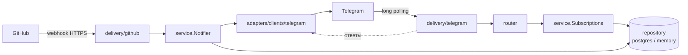

# 🕊 PR Pigeon

Telegram-бот, который приносит уведомления о pull request'ах прямо в личку: назначили на PR, позвали на ревью, оставили комментарий, смержили. Больше не нужно держать открытой вкладку GitHub и проверять «а не ждут ли меня».

Финальный проект курса по Go: GitHub webhooks → HTTPS-сервер с проверкой подписи → бизнес-логика → Telegram.

[](https://github.com/katshuuu/pr-pigeon/actions/workflows/ci.yml)

## Как это выглядит

```
📌 На вас назначен pull request: Retry Telegram sends on 429 — katshuuu/pr-pigeon#7
Автор: @alice-dev
```
```
🛠 Ревью от @bob-reviewer: нужны правки
Retry Telegram sends on 429 — katshuuu/pr-pigeon#7
│ Логика ретраев ок, но давай вынесем backoff в конфиг.
Открыть на GitHub →
```
```
🎉 Pull request смержен: Retry Telegram sends on 429 — katshuuu/pr-pigeon#7
Спасибо всем, кто ревьюил!
```

| Событие GitHub | Что прилетает | Кому |
|---|---|---|
| `pull_request` → `assigned` / `unassigned` | 📌 назначен / 🕊 сняли | тому, кого назначили |
| `pull_request` → `review_requested` | 👀 ждут на ревью | запрошенному ревьюеру |
| `pull_request` → `closed` | 🎉 смержен / 🗂 закрыт | автору и assignee |
| `pull_request_review` → `submitted` | ✅ / 🛠 / 💬 ревью | автору и assignee |
| `pull_request_review_comment` → `created` | 💬 комментарий к коду | автору и assignee |
| `pull_request_review_thread` → `resolved` / `unresolved` | 🧵 обсуждение | автору и assignee |

Несколько правил, которые я заложила специально:

- **Про свои действия бот не пишет.** Если вы сами оставили комментарий, уведомление получат остальные, но не вы.
- **Исключение — назначение.** Если назначить PR на себя, уведомление всё равно придёт: так проще всего проверить, что всё работает.
- **Без дублей.** Ревью со статусом «commented» без общего текста пропускается: его inline-комментарии и так приходят отдельными событиями.
- Логины GitHub сравниваются без учёта регистра, как и на самом GitHub.

## Команды бота

| Команда | Что делает |
|---|---|
| `/start` | знакомство |
| `/link <ник>` | привязать GitHub-аккаунт к чату. Понимает `octocat`, `@octocat` и `https://github.com/octocat` |
| `/me` | показать, кто привязан |
| `/unlink` | отвязать |
| `/help` | подсказка |

К одному нику можно привязать несколько чатов (например, личку и рабочий чат) — уведомление придёт во все.

## Быстрый старт

### 1. Бот и секрет

1. Создайте бота у [@BotFather](https://t.me/BotFather) и скопируйте токен.
2. Придумайте секрет для вебхука: `openssl rand -hex 32`.
3. `cp .env.example .env` и заполните `TELEGRAM_BOT_TOKEN` и `GITHUB_SECRET`.

### 2. Запуск

Через Docker (бот + PostgreSQL, TLS на порту 8443):

```bash
make up      # сгенерирует самоподписанный сертификат в ./certs и поднимет compose
make logs
```

Или локально, без базы (связки хранятся в памяти):

```bash
make run
```

### 3. Доступ из интернета

GitHub должен достучаться до сервера. Для демо подойдёт [ngrok](https://ngrok.com):

```bash
ngrok http https://localhost:8443   # если запущено через make up (TLS)
ngrok http 8080                     # если make run без TLS
```

### 4. Вебхук на GitHub

**Settings → Webhooks → Add webhook** в нужном репозитории:

- **Payload URL:** `https://<ваш-домен-ngrok>/api/v1/github/webhook`
- **Content type:** `application/json` (на `x-www-form-urlencoded` сервер ответит 415 с подсказкой)
- **Secret:** значение `GITHUB_SECRET`
- **Events:** *Let me select individual events* → Pull requests, Pull request reviews, Pull request review comments, Pull request review threads

После сохранения GitHub пришлёт `ping` — в логах появится `ping from github, webhook is configured correctly`.

### 5. Проверка

Напишите боту `/link <ваш-ник>`, создайте PR и назначьте себя assignee. Голубь прилетит 🕊

Без GitHub можно отправить подписанный запрос вручную:

```bash
GITHUB_SECRET=... ./scripts/send-test-webhook.sh \
  internal/delivery/github/testdata/pull_request_assigned.json pull_request
```

## Конфигурация

Всё настраивается переменными окружения. Полный список с комментариями — в [`.env.example`](.env.example).

| Переменная | По умолчанию | Описание |
|---|---|---|
| `TELEGRAM_BOT_TOKEN` | — | токен бота, **обязательно** |
| `GITHUB_SECRET` | — | секрет вебхука для проверки HMAC, **обязательно** |
| `PORT` | `:8080` | адрес сервера, можно `8080` или `:8080` |
| `TLS_CERT_FILE`, `TLS_KEY_FILE` | — | сертификат и ключ; если заданы оба — сервер поднимается по HTTPS |
| `HTTP_READ_HEADER_TIMEOUT` | `5s` | защита от slowloris |
| `HTTP_READ_TIMEOUT` / `HTTP_WRITE_TIMEOUT` / `HTTP_IDLE_TIMEOUT` | `10s` / `15s` / `60s` | таймауты сервера |
| `NOTIFY_TIMEOUT` | `8s` | сколько ждать отправки в Telegram (GitHub ждёт ответа ~10 с) |
| `SHUTDOWN_TIMEOUT` | `10s` | время на graceful shutdown |
| `DB_HOST`, `DB_PORT`, `DB_USERNAME`, `DB_PASSWORD`, `DB_NAME`, `DB_SSLMODE` | `DB_PORT=5432`, `DB_NAME=pigeon` | PostgreSQL; без `DB_HOST` используется in-memory хранилище |
| `LOG_LEVEL` | `info` | `debug`, `info`, `warn`, `error` |
| `LOG_FORMAT` | `json` | `json` для продакшена, `text` для разработки |

Ошибки конфигурации собираются все сразу, а не по одной: сервис не стартует и перечисляет, что не так.

## Архитектура



```
cmd/pigeon/                      точка входа, graceful shutdown по SIGINT/SIGTERM
internal/
  app/                           сборка зависимостей, запуск сервера и бота
  config/                        чтение и валидация env
  logger/                        slog: json/text, уровень из LOG_LEVEL
  domain/                        Subscription, PREvent, валидация логина
  delivery/
    github/                      HTTP-обработчик вебхуков, HMAC, разбор payload'ов
    telegram/                    приём апдейтов через long polling
    httpserver/                  TLS-сервер, таймауты, middleware (логи, recover)
  router/                        разбор команд бота → вызов сервиса
  service/                       бизнес-логика: кому и что отправить
  repository/{postgres,memory}   хранение связок chat_id ↔ github_login
  adapters/clients/telegram/     отправка сообщений через go-telegram-bot-api
build/package/Dockerfile         multi-stage сборка в distroless
scripts/                         генерация сертификатов, тестовый вебхук
```

Слои общаются через маленькие интерфейсы, которые объявлены там, где используются. Например, `service` не знает ни про HTTP, ни про Telegram: на вход получает `domain.PREvent`, на выход отдаёт текст в `Sender`. Если завтра понадобится слать уведомления в Slack, поменяется только адаптер.

Пара решений, о которых стоит сказать:

- **Подпись проверяется до всего остального**, сравнение — через `hmac.Equal` (константное время). Размер тела ограничен 1 МБ.
- **Отправка не обрывается, если GitHub закрыл соединение**: контекст запроса отвязан через `context.WithoutCancel`, но ограничен `NOTIFY_TIMEOUT`.
- **Ошибка в одном чате не блокирует остальные**: notifier отправляет всем, а ошибки собирает через `errors.Join`.
- **TLS** — минимум 1.2, только AEAD-шифры, X25519/P-256.
- **Образ** собирается в `distroless/static:nonroot`: ни shell, ни root.
- Логи библиотеки `tgbotapi` перенаправлены в `slog`, чтобы весь вывод был в одном формате.

## Тесты

```bash
make test    # go test -race ./...
make cover   # покрытие
make lint    # golangci-lint
```

Покрытие — около 90%. Обработчик вебхуков тестируется на настоящих (сокращённых) payload'ах GitHub из `testdata/`, PostgreSQL-репозиторий — через `sqlmock`, Telegram — через фейки на месте интерфейсов. CI в GitHub Actions гоняет тесты, линтер и сборку Docker-образа.

## Что дальше

Идеи, до которых пока не дошли руки:

- дедупликация по `X-GitHub-Delivery` (GitHub может прислать событие повторно при редоставке);
- повтор отправки при `429 Too Many Requests` с учётом `retry_after`;
- автоматическая отвязка, если пользователь заблокировал бота (Telegram отвечает 403);
- тихие часы: копить уведомления ночью и присылать утром одним сообщением;
- поддержка запросов ревью на команду (`requested_team`).

---

Сделано Катей Шусталовой · [GitHub](https://github.com/katshuuu) · [Telegram](https://t.me/katshuuu)
